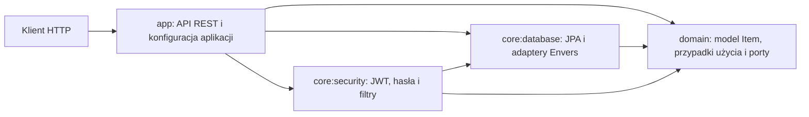

# Betacom

Backend udostępnia interfejs REST do obsługi kont użytkowników i obiektów `Item`: ich tworzenia, edycji, udostępniania oraz przeglądania historii zmian. Projekt opiera się na Javie 21, Spring Boot, MySQL, Hibernate Envers, Bucket4j i JWT.

## Architektura

Projekt oddziela reguły biznesowe od frameworków i infrastruktury. Składa się z czterech modułów Gradle:



- **`domain`** zawiera główny model domenowy `Item`, uprawnienia `Permission`, reguły biznesowe, przypadki użycia i porty. Nie zależy od frameworka Spring ani od JPA.
- **`core:database`** zawiera encje JPA, repozytoria Spring Data, mapery, konfigurację Envers i adaptery implementujące porty domenowe.
- **`core:security`** obsługuje JWT, hashowanie haseł, limit prób logowania i kontekst uwierzytelnionego użytkownika w bieżącym żądaniu. Implementuje porty bezpieczeństwa i przekazuje identyfikator użytkownika do metadanych rewizji Envers.
- **`app`** udostępnia API REST, waliduje DTO żądań, mapuje odpowiedzi, obsługuje błędy i łączy moduły. Lista obiektów `Item` korzysta z projekcji Spring Data. Tworzenie, edycja, udostępnianie i odczyt historii przechodzą przez przypadki użycia domenowe.

Architektura heksagonalna oddziela reguły biznesowe od szczegółów technicznych. Porty określają, jakich usług potrzebuje domena, a adaptery bazy danych i bezpieczeństwa je udostępniają. Dzięki temu przypadki użycia można testować bez uruchamiania infrastruktury, a wykorzystywane technologie zmieniać bez modyfikowania reguł domenowych.

## Konfiguracja

Utwórz lokalny plik `.env` na podstawie szablonu. W razie potrzeby zmień w nim wartości:

```powershell
Copy-Item .env.example .env
```

Podczas lokalnego uruchomienia Spring Boot wczytuje wartości z pliku `.env`. Zmienne ustawione w systemie mają pierwszeństwo przed tymi z pliku. Docker Compose i Podman Compose korzystają z `.env` przy podstawianiu wartości w konfiguracji kontenerów.

| Zmienna | Wartość w `.env.example` | Zastosowanie |
| --- | --- | --- |
| `SPRING_DATASOURCE_URL` | `jdbc:mysql://localhost:3306/betacom` | URL bazy MySQL, gdy aplikacja działa bezpośrednio na komputerze |
| `COMPOSE_SPRING_DATASOURCE_URL` | `jdbc:mysql://db:3306/betacom` | URL bazy MySQL używany przez aplikację uruchomioną w Compose |
| `SPRING_DATASOURCE_USERNAME` | `betacom` | Nazwa użytkownika bazy używana przez aplikację |
| `SPRING_DATASOURCE_PASSWORD` | `betacom` | Hasło do bazy używane przez aplikację |
| `MYSQL_DATABASE` | `betacom` | Nazwa bazy tworzonej w kontenerze MySQL |
| `MYSQL_USER` | `betacom` | Nazwa użytkownika tworzonego w MySQL; musi być zgodna z `SPRING_DATASOURCE_USERNAME` |
| `MYSQL_PASSWORD` | `betacom` | Hasło użytkownika MySQL; musi być zgodne z `SPRING_DATASOURCE_PASSWORD` |
| `MYSQL_ROOT_PASSWORD` | `root` | Hasło użytkownika `root` w kontenerze MySQL |
| `JWT_SECRET` | Wartość deweloperska | Sekret HMAC. Poza lokalnym środowiskiem ustaw losową wartość o długości co najmniej 32 bajtów UTF-8 |
| `JWT_EXPIRATION` | `PT1H` | Czas ważności tokenu JWT, np. `PT1H` (jedna godzina) |
| `LOGIN_RATE_LIMIT_CAPACITY` | `5` | Liczba dozwolonych prób logowania z jednego adresu IP w oknie limitu |
| `LOGIN_RATE_LIMIT_WINDOW` | `PT1M` | Długość okna limitu; `PT1M` oznacza jedną minutę |

Git ignoruje plik `.env`. Nie umieszczaj w repozytorium prawdziwych haseł ani sekretów. Wartości z `.env.example` są przeznaczone wyłącznie do lokalnego uruchamiania.

## Uruchomienie lokalne

Zainstaluj JDK 21 i uruchom MySQL na komputerze. Następnie, po utworzeniu pliku `.env`, uruchom aplikację:

```powershell
.\gradlew.bat :app:bootRun
```

Aplikacja będzie dostępna pod adresem <http://localhost:8080>. Na macOS i Linuksie uruchom ją poleceniem `./gradlew :app:bootRun`.

## Docker Compose

Po zainstalowaniu Docker Compose i utworzeniu pliku `.env` uruchom aplikację i bazę danych w tle:

```sh
docker compose up --build -d
```

Opcja `-d` uruchamia kontenery w tle. Logi działających usług nie będą wyświetlane w tej konsoli. Aplikacja będzie dostępna pod adresem <http://localhost:8080>. Aby wyświetlić logi na bieżąco, użyj polecenia:

```sh
docker compose logs -f
```

Polecenie usuwa kontenery, ale pozostawia wolumen z danymi bazy. Aby je wykonać, uruchom:

```sh
docker compose down
```

Aby usunąć także wolumen z danymi bazy, uruchom `docker compose down --volumes`.

## Podman Compose

W Podman Desktop lub Linuksie zainstaluj narzędzie obsługujące Compose, np. `podman-compose` albo `docker-compose`. Następnie uruchom usługę API i bazę MySQL w tle:

```sh
podman compose up --build -d
```

Opcja `-d` uruchamia kontenery w tle. Logi działających usług nie będą wyświetlane w tej konsoli. Aplikacja będzie dostępna pod adresem <http://localhost:8080>. Aby wyświetlić logi na bieżąco, użyj polecenia:

```sh
podman compose logs -f
```

Polecenie usuwa kontenery, ale pozostawia wolumen z danymi bazy. Aby je wykonać, uruchom:

```sh
podman compose down
```

Aby usunąć także wolumen z danymi bazy, uruchom `podman compose down --volumes`.

## Testy

Testy jednostkowe modułu `domain` uruchomisz poleceniem:

```sh
./gradlew :domain:test
```

W systemie Windows użyj `.\gradlew.bat :domain:test`. Testy integracyjne API korzystają z Testcontainers i wymagają działającego Dockera lub Podmana:

```sh
./gradlew :app:integrationTest
```

Testy integracyjne sprawdzają działanie API, historię zmian obiektów `Item` zapisywaną przez Envers, limit prób logowania, uprawnienia i równoczesną edycję `Item`.
